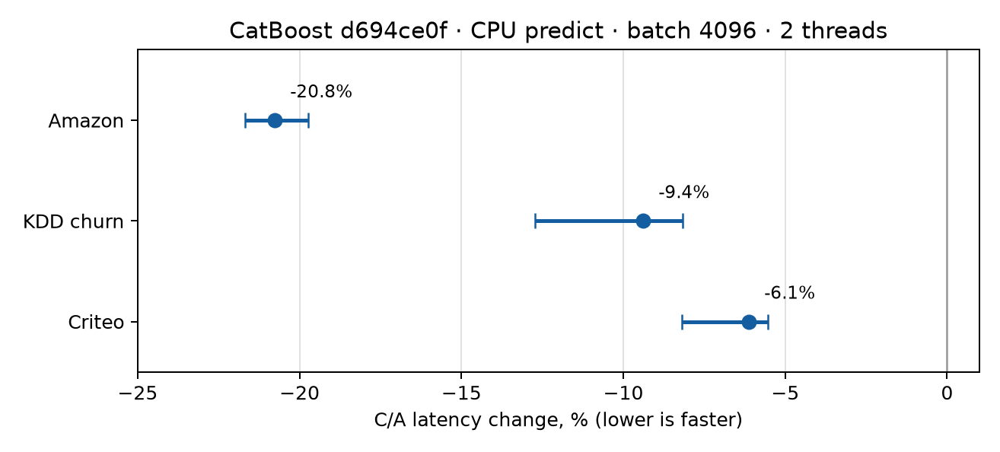
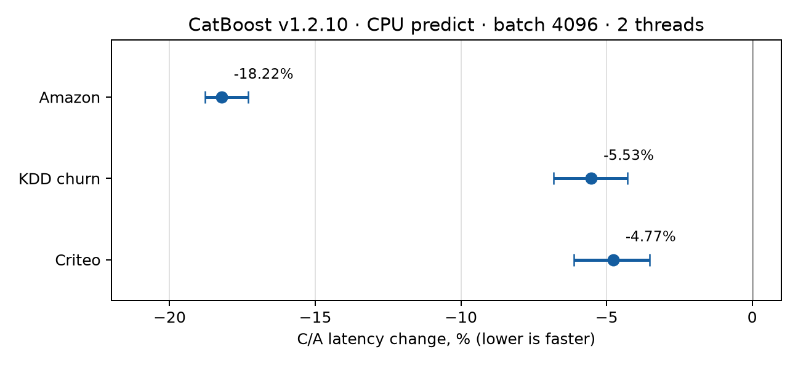

# CPU CTR inference: review results

The proposed CatBoost change is confined to
`catboost/libs/model/static_ctr_provider.cpp` and `.h` (165 added, 4 removed
lines). It reuses bucket lookups for neighbouring CTRs backed by one table and
caches the projection grouping across `CalcCtrs` calls. The grouping cache is
thread-local; a hit requires the same source array and an exact, independent
snapshot of its projection sequence. CTR definitions and model predictions are
unchanged.

## Fresh check on CatBoost `d694ce0f`

`A` is stock CatBoost; `C` contains the two code commits. This measures CPU
`predict` on an already constructed Pool: batch 4096, two threads, 200 calls
per process, nine paired sessions per model. The measured latency is the mean
of the final 20 calls in execution order. The point is the median of paired
`C/A − 1` changes; the 95% interval bootstraps whole pairs (20,000 draws).

| Held-out model/data | A, ms | C, ms | Median C/A | 95% interval | Faster pairs |
|---|---:|---:|---:|---:|---:|
| Amazon Employee Access | 2.3918 | 1.8970 | **−20.76%** | [−21.69%, −19.73%] | 9/9 |
| KDD Cup 2009 churn | 7.0803 | 6.3595 | **−9.38%** | [−12.72%, −8.17%] | 9/9 |
| Criteo Click Logs sample | 9.4271 | 8.7991 | **−6.12%** | [−8.19%, −5.53%] | 9/9 |



Before timing, full-holdout prediction hashes matched A/C for 6,554 Amazon,
12,500 KDD and 757,695 Criteo rows. The cache hit/miss regression, controlled
known-key/fallback CTR fixture and shared-provider check (4 threads × 200
calls) returned `PASS`. The `model_ut` target completed with exit code 0 (35
successful test lines). Hash agreement is empirical evidence, not a proof of
bitwise identity or absence of all races; ThreadSanitizer was not rerun on
this revision.

## Earlier v1.2.10 experiment

The independent earlier series on CatBoost `b1bd2a6d7721` found −18.22%
Amazon, −5.53% KDD and −4.77% Criteo in the same headline workload. It is
shown separately because changing the CatBoost revision changes the baseline.



Both series use one macOS arm64 host per run and existing models/holdouts;
neither establishes a universal percentage. The new run did not remeasure
Pool construction, other batch sizes, Linux x86-64 or cold one-call inference.
The Criteo data is a sample, not the full source dataset. The experimental
`cat-hash-cache` patch is excluded because its earlier DSV result did not
reproduce and it hurt `predict`.

[`full-evidence.tar.gz`](full-evidence.tar.gz) (276 KiB) preserves the detailed
protocols, all raw session records, reports, source/hashes of the benchmark
harness, targeted test outputs, and figure-generation scripts from both
series. It is compressed so the review diff stays focused on the two CatBoost
files and this summary. SHA-256:
`13e6f95ea2a7f5cde43c85a65fe18705d4e0b84341684a01aa6debc0d42c5562`.
To inspect it locally:

```sh
mkdir -p /tmp/catboost-ctr-evidence
tar -xzf research/full-evidence.tar.gz -C /tmp/catboost-ctr-evidence
```
