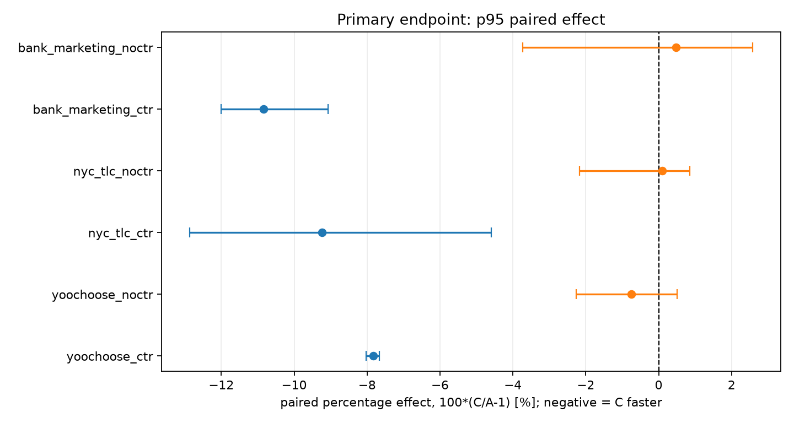

# CTR inference on three additional datasets

This is a compact evidence set for the CPU CTR change in this branch. It does
not contain the datasets, trained models, binaries, or per-call timing files.
The experiment used **stock CatBoost v1.2.10 (A)** and the same version with
both CTR optimizations (C). It is separate from the current-master measurements
in [the parent summary](../README.md); results from the two builds are not pooled.

The predeclared primary endpoint was the paired change in **p95 predict latency**
on an already constructed Pool, with 4096 predicted rows and two threads. Each
model had 20 paired fresh-process sessions; each process ran 50 warm-up and
2000 timed calls. Negative values mean C was faster.

| Held-out model | CTR features | Median paired C/A | 95% bootstrap CI | Faster pairs | Holm-adjusted p |
|---|---:|---:|---:|---:|---:|
| YOOCHOOSE RecSys 2015 | 112 | **−7.83%** | [−8.02%, −7.66%] | 20/20 | 0.00015 |
| NYC TLC yellow taxi 2025 | 150 | **−9.24%** | [−12.86%, −4.60%] | 18/20 | 0.00015 |
| UCI Bank Marketing | 117 | **−10.85%** | [−12.00%, −9.07%] | 20/20 | 0.00015 |

All three no-CTR controls had p95 confidence intervals crossing zero. Full
holdout predictions matched bit-for-bit for A and C on all six models before
timing. The measured effect concerns ready-Pool prediction on one macOS arm64
host. Pool construction, Linux x86-64, other batch sizes, and a universal
percentage across CatBoost models were not established by this run.

## What is in Git

- [Protocol](protocol.md): fixed before downloading data and training; includes
  model setup, split rules, workload, bootstrap and correction rules.
- [Machine-readable results](results.json): the primary p95 effects, intervals,
  hashes and control results. It records the SHA-256 of the full local report.
- [Paired p95 observations](paired_p95.csv): one row per model and session,
  computed with `numpy.percentile(raw_per_call_ms, 95)` for each arm. The effect
  column is `100 * (optimized_p95_ms / stock_p95_ms - 1)`. Its median reproduces
  each headline effect; the interval bootstraps these 20 whole paired effects
  with 20,000 draws and seed 20261026, as specified in the protocol.
- [Source manifest](source-manifest.json): original download URLs and hashes.

The original downloads and complete per-call timing files are retained locally
in `SRW2iter/data/confirmatory/` and
`SRW2iter/results/local/confirmatory-3-datasets-20261026-1345/` for reruns.
They are intentionally excluded from this Git commit. This small evidence set
allows the published paired effects to be checked without adding gigabytes of
source data to the CatBoost review.
